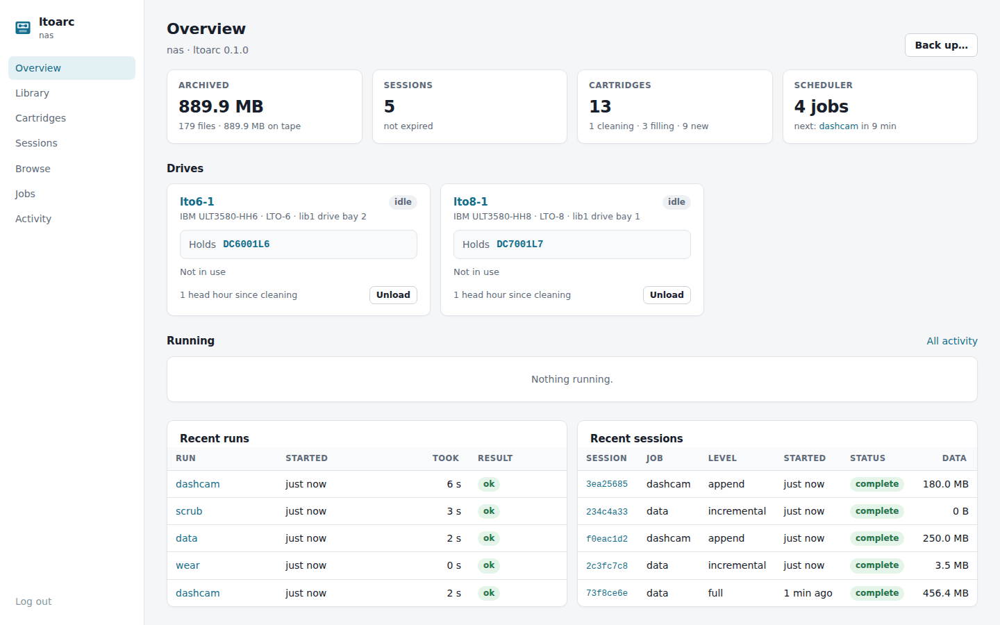
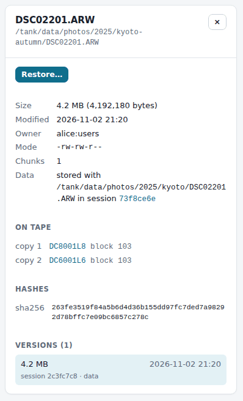
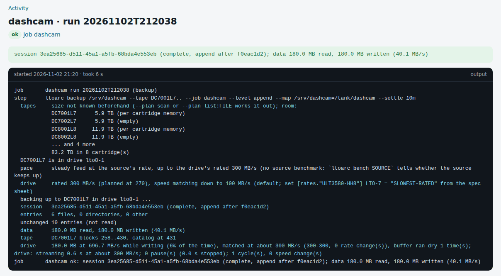
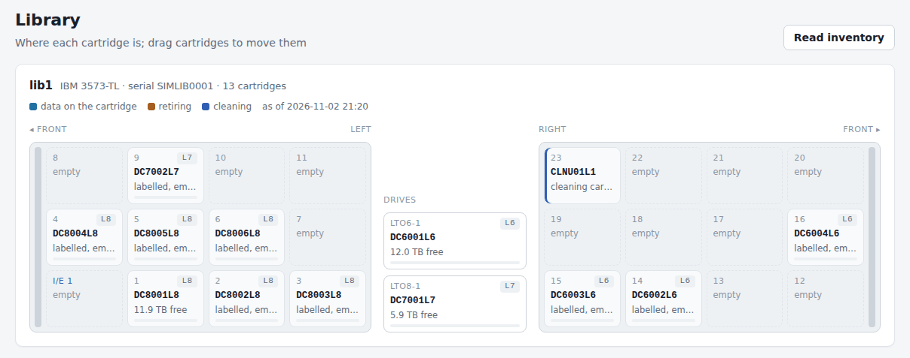
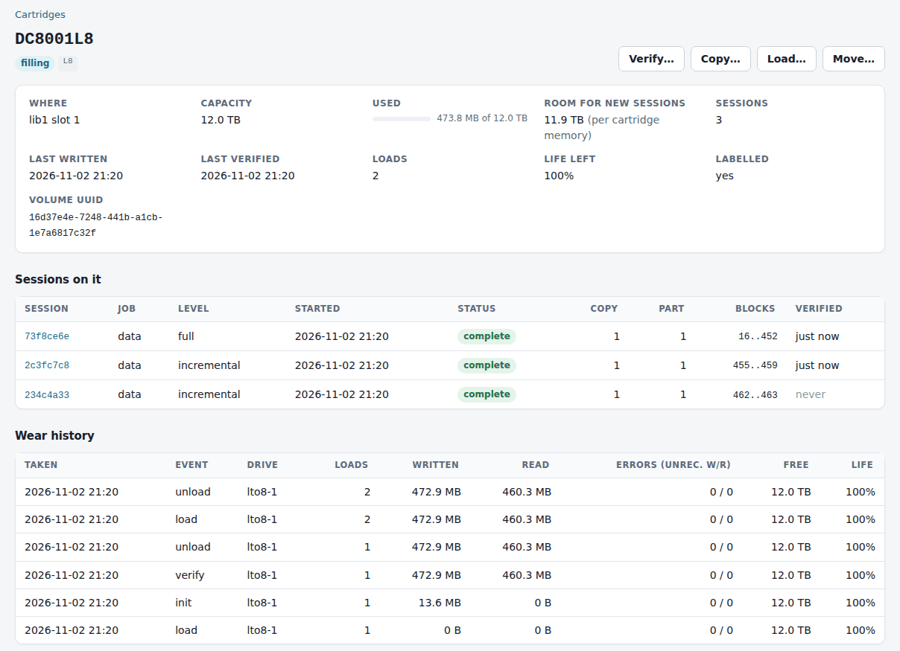
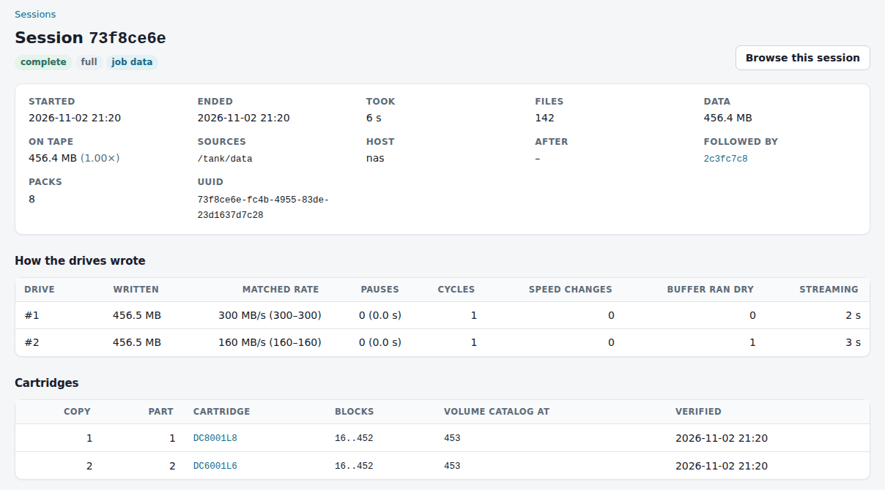

# ltoarc

A tape-native archiver for LTO drives and libraries on Linux. One binary, a SQLite catalog that
knows where every file sits on tape, drives that stream instead of shoe-shining, and a built-in
scheduler and web interface.

> **Status:** Release v0.1.0. See [Status and limitations](#status-and-limitations).

## Contents

- [What it is](#what-it-is)
- [Why ltoarc](#why-ltoarc)
- [Common usage](#common-usage)
- [Installation](#installation)
- [Features](#features)
- [Configuration files](#configuration-files)
- [Status and limitations](#status-and-limitations)
- [License](#license)
- [Command reference](#command-reference)

## What it is

- **An archiver for the machine your tape hardware is attached to.** It backs up local
  directories (and anything mounted there) to LTO cartridges, in a drive or a library.
- **One session per backup**, written to a *tape set*: as many cartridges as it needs, of any
  cartridge generation / libraries with compatible drives mix.
- **A catalog of every file version** (SQLite): which session, which cartridge, which block. You
  can list, search and browse the archive without touching a tape.
- **Self-describing cartridges.** Each one carries its own index, the format specification and
  the ltoarc binary, so the data stays readable without the catalog.
- **Everything around the backups:** copies, verification, retention, wear tracking, cleaning,
  scheduled jobs, notifications, a FUSE mount and a web interface.

## Why ltoarc

- **Single-file restores in one locate.** The catalog holds each file's cartridge, block and
  offset, so a restore reads only what it needs, in tape order.
- **Drives that stream.** A large memory buffer feeds the drive at a steady rate inside its
  speed-matching range, instead of stop-start bursts that wear tape and heads. Every run
  reports the pauses the drive itself counted, not just an average rate.
- **Tapes that outlive the software.** Every cartridge ends each session with a volume catalog,
  and starts with a bootstrap file holding the binary and `FORMAT.md`. `tape scan` rebuilds
  the catalog from cartridges alone.
- **Incrementals without re-reading.** Unchanged files are skipped by size, times and inode.
  Moved and renamed files are stored by reference. `--as-of` restores any point exactly.
- **Copies across generations and libraries.** Write two copies at once (LTO-8 and LTO-6, say),
  or make one, and later tape to tape or from the source disks, checked against the original
  checksums.
- **Your existing checksums count.** Hash digests kept in xattrs, by ltoarc or by another tool,
  are reused instead of re-reading files, and can be written back.
- **Small to run.** One binary and one SQLite file. The scheduler and web interface are built
  in: no database server, no agents, no web server.

**Compared with other tools:**

- **`tar` or `dd` to tape:** no index, so finding a file means reading the tape. Spanning is
  manual (`tar -M`). A slow source makes the drive shoe-shine unless a buffer is added.
- **LTFS:** each cartridge is its own filesystem. There is no catalog across cartridges, files
  do not span cartridges, and there are no incremental or versioned backups. Copying many files
  out in directory order makes the tape seek back and forth.
- **Bacula, Bareos, Amanda:** built for many clients over a network, with several daemons, a
  database server and a lot of configuration. ltoarc is for the one host the drives hang off.

**Good fit:**

- a Linux server or NAS (filesystem with or without snapshot) with an LTO drive or library;
- photo, video and project archives, and moving finished work off disk;
- dash cams, camera cards, footage and logs (append-only sources);
- rotation schemes and offsite copies.

**Not a fit (yet):**

- Windows or macOS;
- backing up many machines over the network (mount their shares locally first);
- drives that are not reachable through SCSI generic (`/dev/sg*`).

## Common usage

**First time with a library:**

    ltoarc hw scan                      # find libraries and drives
    ltoarc tape register                # record the barcodes in the library
    ltoarc tape list

**Back up a directory:**

    ltoarc backup /data --tape DC8001L8..          # blank cartridges are labelled on the way

**Check first that the set of cartridges is big enough:**

    ltoarc backup /data --tape DC8001L8.. --plan scan --dry-run

**Nightly incrementals, with a job name** (needed for levels other than full and for retention):

    ltoarc backup /data --tape DC8001L8.. --job data                       # the first, full one
    ltoarc backup /data --tape DC8001L8.. --job data --level incremental

**Two copies at once, on another generation:**

    ltoarc backup /data --tape DC8001L8.. --tape2 DC6001L6..DC6020L6 --job data

**Find and restore files:**

    ltoarc find '*.mov' --under /data
    ltoarc ls -l /data/photos/2025
    ltoarc restore /data/photos/2025 --to /restore --strip-prefix /data
    ltoarc restore /data/report.pdf --to /restore --as-of "2026-10-30 18:00"

**Browse the whole archive as a filesystem:**

    ltoarc mount /mnt/archive                      # offline: names, sizes, xattrs
    ltoarc mount /mnt/archive --online             # contents read from tape on demand

**Check a cartridge reads back:**

    ltoarc verify DC8001L8

**Send a cartridge offsite:**

    ltoarc tape move DC8001L8 ie                   # to the I/E slot

**Schedule it all** (jobs in `~/.config/ltoarc/jobs.toml`, see
[Jobs and the scheduler](#jobs-and-the-scheduler)):

    ltoarcd --web 127.0.0.1:8470
    ltoarc daemon url                              # prints the link that logs in

**Lost the catalog:**

    ltoarc tape register
    ltoarc tape scan DC8001L8                      # for each cartridge, in session order

## Installation

### Requirements

- **Linux**, with LTO drives reached through SCSI generic (`/dev/sg*`) and libraries through
  SMC. Tested with an IBM LTO-8 half-height drive in an IBM 3573-TL library. LTO-3 to LTO-9 and
  M8 are handled; other generations are exercised in the simulator.
- **A Rust toolchain** (1.85 or later) to build.
- **FUSE 3** (`fusermount3`) for mounts.
- **`curl`** for webhook and ntfy notifications.

### From a release

Each release has a Linux x86_64 binary (glibc 2.35 or later: Ubuntu 22.04, Debian 12 or
newer). Download `ltoarc-VERSION-x86_64-linux.tar.gz` and its `.sha256` from the release page,
then:

    sha256sum -c ltoarc-v0.1.0-x86_64-linux.tar.gz.sha256
    tar xzf ltoarc-v0.1.0-x86_64-linux.tar.gz
    sudo install -m 755 ltoarc-v0.1.0-x86_64-linux/ltoarc /usr/local/bin/
    sudo ln -s ltoarc /usr/local/bin/ltoarcd
    sudo ln -s /usr/local/bin/ltoarc /usr/local/sbin/mount.ltoarc

### Build and install

    cargo build --release
    sudo install -m 755 target/release/ltoarc /usr/local/bin/
    sudo ln -s ltoarc /usr/local/bin/ltoarcd                          # the scheduler
    sudo ln -s /usr/local/bin/ltoarc /usr/local/sbin/mount.ltoarc     # for mount -t ltoarc

The same binary acts as `ltoarcd` and `mount.ltoarc` when called by those names.

### Permissions

- **Devices:** read and write access to the drives' and libraries' `sg` devices. Usually that
  is group `tape` (`sudo usermod -aG tape $USER`), or root.
- **Sources:** backing up every file, restoring owners and writing xattrs to sources need root
  or the matching capabilities.
- **Locks:** drive and library locks go in `/run/lock/ltoarc` (`lock_dir` in the config).

### Files

| File | Default | Override |
|---|---|---|
| Catalog | `~/.local/share/ltoarc/catalog.db` | `--catalog FILE`, `LTOARC_CATALOG`, `catalog =` in the config |
| Settings | `~/.config/ltoarc/config.toml` (optional) | `--config FILE` |
| Jobs | `~/.config/ltoarc/jobs.toml` | `--jobs FILE` |
| Scheduler logs, web token | `~/.local/state/ltoarc/` | `state =` in `[daemon]` |
| Scheduler socket | `$XDG_RUNTIME_DIR/ltoarc/ltoarcd.sock` | `socket =` in `[daemon]` |

- **Both files are optional.** Without `config.toml`, defaults apply; without `jobs.toml`, there
  are no jobs, and `ltoarcd --web 127.0.0.1:8470` serves only the web interface. A file named
  with `--config` or `--jobs` has to exist.

### Running the scheduler as a service

    # /etc/systemd/system/ltoarcd.service
    [Unit]
    Description=ltoarc scheduler
    After=local-fs.target

    [Service]
    ExecStart=/usr/local/bin/ltoarcd --wait-tapes 12h
    KillSignal=SIGTERM
    TimeoutStopSec=infinity

    [Install]
    WantedBy=multi-user.target

- **Paths:** run as root, the catalog, jobs file and logs are under `/root` (`~/.local/share`,
  `~/.config` and `~/.local/state`). Without `$HOME`, as in a system service, ltoarc takes the
  user's home directory from the passwd database. Pass `--catalog` and `--jobs`, and set
  `state` in `[daemon]`, to keep them elsewhere.
- **On SIGTERM** the scheduler lets running jobs finish, hence `TimeoutStopSec=infinity`.
- **`ltoarc daemon url`** must run as the daemon's user (`sudo ltoarc daemon url` here), since
  it reads the token from the daemon's state directory.

### Trying it without hardware

The simulator runs every command against simulated libraries, drives and cartridges:

    ltoarc sim create /tmp/w --drive LTO-8 --drive LTO-6 --tapes DC8001L8..DC8005L8 \
        --tapes DC6001L6..DC6005L6 --tapes CLNU01L1 --capacity 1GiB
    alias lt='ltoarc --sim /tmp/w --sim-only --catalog /tmp/w/catalog.db'
    lt hw scan
    lt tape register
    lt backup ~/Pictures --tape DC8001L8..

## Features

### Catalog and self-describing tapes

- **The catalog** (SQLite) holds the libraries, drives, cartridges, sessions, the path tree,
  file versions, their hashes, chunks and placements (copy, cartridge, block, offset). It is the
  primary index.
- **Every cartridge describes itself:**
  - the label (block 0);
  - a bootstrap file: a tar archive with the ltoarc binary (from a release build),
    `FORMAT.md` and recovery notes;
  - the sessions, each followed by a *volume catalog* of what that cartridge holds.
- **Losing the catalog loses no data.** `tape scan` rebuilds it from the cartridges, and
  scheduled jobs can keep a copy of the whole catalog on disk (`catalog_copy`).
- **Crash safety.** Cartridge memory (MAM attribute 080Ch) marks a cartridge open while a
  session writes to it. After a crash or power cut, the next use of the cartridge recovers it:
  - what reached the tape is catalogued;
  - the file being written is marked truncated;
  - a fresh volume catalog is appended.

The on-tape format is specified in [`docs/FORMAT.md`](docs/FORMAT.md).

### Cartridges and tape sets

- **Registering.** `tape register` reads library inventories and records every barcode. A
  cartridge whose barcode the library cannot read is registered by slot, under a name of your
  choice: `tape register --slot 4 --name SPARE01`.
- **Labelling.** Blank cartridges are labelled when a backup reaches them, or ahead of time
  with `tape init`. `tape init --m8` formats a new LTO-7 cartridge as Type M (9 TB) in an LTO-8
  drive; this cannot be undone.
- **Moving.** `tape move` puts cartridges in other slots, one at a time or several at once
  (cartridges that change places go through a free slot). `ie` sends one to an I/E slot to be
  taken out.
- **Unregistering.** `tape unregister` removes a cartridge registered by mistake. One that holds
  sessions needs `--force`, and the sessions held only on it are forgotten with it.

**Tape sets.** Commands that write (`--tape`, `--tape2`, `copy --to`) take a set of cartridges:

| Form | Meaning |
|---|---|
| `DC8001L8` | that cartridge |
| `DC8001L8,DC8005L8` | a list (each item may be a range) |
| `DC8001L8..DC8020L8` | that range, LTO-8 cartridges only |
| `DC8001..DC8020` | that range, any generation: a set may mix generations and libraries |
| `DC8001L8..DC8020` | that range, preferring L8 where a number exists in several generations |
| `DC8001..` or `DC8001L8..` | from DC8001 to the highest registered number of the series, any generation (the second prefers L8) |

- **Gaps:** numbers of a range that are not registered are skipped.
- **Open ranges take every generation of the series,** so a session or job carries on onto
  cartridges of other generations as they are added: `DC6001L6..` also takes DC7001L7 and
  DC8001L8 once they are registered. To keep a set to one generation, close the range with its
  media type: `DC6001L6..DC6999L6`.
- **Ambiguous numbers:** when a number is registered in several generations and the range does
  not say which to prefer, ltoarc asks, or stops when not run from a terminal.
- **Order:** a session appends to the first cartridge of the set that has room, and continues on
  the next ones as each fills.
- **Drives:** each cartridge goes to a drive that can write its generation, moving the session
  to another drive or library when needed.

### Backing up

    ltoarc backup SOURCE... --tape SET [--job NAME] [--level full|incremental|differential|append]

**Levels:**

- `full` saves everything.
- `incremental` saves what changed since the job's last session.
- `differential` saves what changed since the job's last full session.
- `append` saves only files the job never archived (see [Append-only sources](#append-only-sources)).

Incremental and differential sessions also record deletions, so `--as-of` restores any point
exactly.

**How files go to tape:**

- Large files are written first and whole.
- Small files (up to `--pack-max`, 1 MiB) are packed together in packs of about 16 MiB, and
  written between large files.
- Every chunk gets a BLAKE3 hash.
- Optional zstd compression (`--zstd LEVEL`) skips video, images and archives. Drive compression
  is off by default (`--drive-compression`).

#### Will it fit?

With a known size, ltoarc lists which cartridges it will write to and how much goes on each,
which are not needed, or by how much the set falls short. Copies know their size from the
catalog; backups know it with `--plan scan` (a stat-only pass) or `--plan list:FILE`.

    $ ltoarc backup /data --tape DC5001L5.. --plan scan --dry-run
    tapes     about 3.4 TB to write
              DC5001L5      1.1 TB of    1.1 TB room (per cartridge memory)
              DC5002L5      1.5 TB of    1.5 TB room (empty)
              DC5003L5    790.0 GB of    1.5 TB room (empty)
              not needed: DC5004L5..DC5020L5 (17 cartridges)
              3 cartridge(s) of 20

- **Path lists.** `--plan list:FILE` takes a list of paths, one per line or NUL-separated, and
  stats only those. Any indexer works: `find /data -print0 > list`, a locate database's output,
  or your own file index. Paths outside the sources are ignored.
- **Room on a cartridge** comes from its cartridge memory, when that was read after the last
  session written to it, or else from the catalog. Empty, expired and overwritten cartridges
  count whole.

#### Incremental sessions

- Entries with the same size, mtime, ctime and inode as in the job's earlier sessions are
  neither read nor written again.
- Paths that disappeared are recorded as deleted.
- Hash write-back updates the ctime ltoarc compares against, so tagging a file does not make it
  new.

#### Moves and duplicates

A new or changed file whose content is already on tape is stored by reference:

- `--dedup moves` (the default) covers files moved or renamed since the job's earlier sessions;
- `--dedup all` covers any archived file with the same content;
- `--self-contained` never refers to other sessions, so a restore needs no other session's
  tapes.

Content is matched by digest:

- a fresh digest in an xattr needs no read at all;
- otherwise the file is hashed first, but only when an archived file of the same size exists;
- a fingerprint match is trusted, or confirmed by hashing with `--fingerprint-trust confirm`.

#### Overwriting instead of appending

`--overwrite` starts each cartridge the session reaches afresh: it is relabelled, and the
sessions it held are forgotten. Use it for rotation schemes.

- **Before writing,** ltoarc lists what each of those cartridges holds, and how many of those
  sessions no other copy has.
- **Then it asks.** `--yes` skips the question; without a terminal, `--yes` is required.
- **Expired cartridges** (all their sessions expired) are reused the same way, without asking.

#### Resuming

A session cut short ends *partial*: interrupted (Ctrl-C, a crash, a power cut), or out of
cartridges. `--resume` continues it:

    ltoarc backup /data --tape DC8001.. --resume

- **What is skipped:** files the partial session holds complete and unchanged.
- **Which session:** the newest session of the job (`--job`), or, without a job, the newest
  job-less session of exactly these sources. It must have ended partial.
- **The result:** an incremental session after the partial one. Restores of the latest state
  combine both.
- A job run at level `incremental` resumes by itself.

#### Deleting the sources (moving to tape)

`--delete-source` deletes, once the session is complete, the files it holds, then the
directories left empty. The source directories themselves stay.

- **Only unchanged files go:** a file must still match the archived version (size, times,
  inode).
- **Nothing is deleted after a partial session.** Resume it first.
- **Not with `--map`:** the files read are then a snapshot's.
- To delete only after verified copies exist, use `ltoarc prune` (append-only jobs).

#### Snapshots

Back up a snapshot under the live path, so every run names the files alike:

    zfs snapshot tank/data@ltoarc
    ltoarc backup /tank/data/.zfs/snapshot/ltoarc --map /tank/data/.zfs/snapshot/ltoarc=/tank/data \
        --tape DC8001.. --job data --level incremental
    zfs destroy tank/data@ltoarc

Jobs do this with `pre` and `post` hooks.

#### Stream sources

A command's output becomes a file of the archive, for example a database dump or `zfs send`:

    ltoarc backup --stream /.ltoarc/streams/pg/base='pg_basebackup -Ft -D - -X fetch' --tape DC8001..
    ltoarc cat /.ltoarc/streams/pg/base | tar x -C /restore/pg

A command that fails leaves the file marked unreadable, and the failure is reported.

#### Append-only sources

Dash cams, camera cards and logs use `--level append`:

- only files the job never archived are taken;
- files modified within `--settle` (e.g. `10m`) wait for the next run;
- an archived file that has changed since is reported, not saved again;
- deletions are not recorded.

`ltoarc prune --job NAME --copies 2` then deletes source files that are archived unchanged with
that many copies, each verified since it was written. It only lists them unless given `--yes`.

### Hashes, fingerprints and xattrs

Every chunk is checked with BLAKE3. On top of that, each file can carry hash *profiles*:

- **Content profiles** hash the file's bytes, and are checked again on restore and verify.
  Built in: `blake3` (the default), `sha256`, `sha512`, `sha1`, `md5`, `xxh3`. Their digests go
  in xattr `user.ltoarc.<algo>`, with freshness recorded in `user.ltoarc.meta`.
- **Fingerprint profiles** identify a file but cannot be recomputed from its bytes alone, for
  example a digest derived from the filesystem's block checksums. They come from an xattr kept
  by another tool, or from a command, and drive the matching of moves and duplicates.
- **`--hash-mode`:** `use-existing` (the default) reuses a fresh xattr digest, `generate` always
  computes, `verify` computes and compares (a mismatch suggests bitrot in the source).
- **`--write-back`** writes digests and their freshness record to the sources' xattrs.
- **`--set-xattr NAME=TEMPLATE`** adds xattrs to sources and the archived copy: `{session}`,
  `{date}`, `{barcodes}`, `{job}`, `{<profile>}`.

Define your own profiles in `config.toml`, to reuse checksums your other tools already keep:

    # A content hash under another tool's xattr names
    [hash.sha256sum]
    kind = "content"
    algo = "sha256"
    xattr = "user.checksum.sha256"

    # A content hash computed by an external command (first word of its output)
    [hash.b2]
    kind = "content"
    command = "b2sum {path}"

    # A fingerprint another tool keeps, e.g. one derived from ZFS block checksums
    [hash.mysum]
    kind = "fingerprint"
    xattr = "user.mysum.checksum"
    meta_xattr = "user.mysum.meta"     # "mtime=SECS.NANOS;size=N": stale digests are ignored
    command = "mysum {path}"           # optional: run when the xattr is missing or stale

Then use them by name: `--hash sha256 --hash mysum`.
Be aware of the hash performance when choosing hash algorithm.

- **Freshness:** with `meta_xattr`, a digest whose recorded mtime and size no longer match the
  file is ignored. Without it, the xattr's digest is taken as is.
- **Commands** run through `/bin/sh`, with `{path}` replaced by the quoted path.

### Encryption

Optional, per session:

    ltoarc key new /root/ltoarc.key                     # keep a copy away from the cartridges
    ltoarc backup /data --tape DC8001.. --encrypt /root/ltoarc.key
    ltoarc --key /root/ltoarc.key restore /data/x --to /restore   # or keys = [...] in the config

- **Cipher:** ChaCha20-Poly1305, with a per-session key wrapped by your key file.
- **What is sealed:** everything after the session's first record, volume catalogs included.
  Nothing on tape or in cartridge memory names a file.
- **One key per cartridge:** a cartridge holds either plaintext sessions or sessions under one
  key.
- **Keep copies of the key file.** Without it, an encrypted session cannot be read.

### Copies

    ltoarc backup /data --tape DC8001L8.. --tape2 DC6001L6..DC6020L6   # two copies, one read
    ltoarc copy --from DC8001..DC8002 --to OS0001..                     # tape to tape, later
    ltoarc copy --from-source --session ID --to OS0001..                # from the source disks
    ltoarc restore /data --to /restore --copy 2

- **`--tape2`** writes copy 2 through other drives while copy 1 is written; each copy spans its
  own tape set.
  - The faster drive is matched to the slower one.
  - When one copy runs out of cartridges, the session ends for both, so the copies hold the
    same data.
- **`copy`** makes another copy of the sessions on the source cartridges (or of `--session`).
  - It reads in one drive and writes in another, in the same library or not.
  - Records are copied as they are (compressed, encrypted) and checked against their BLAKE3.
  - The source drive runs at the destination's pace, so neither drive stops.
- **`copy --from-source`** writes the session again from the files on disk.
  - Every chunk is checked against the BLAKE3 recorded when the session was written.
  - Files changed since are left out of the new copy, and named.

All three accept `--dry-run`, `--overwrite` and `--yes` as backups do. Each destination
cartridge ends with its own volume catalog. Check new copies with `ltoarc verify`.

### Restoring and browsing

    ltoarc ls -l /data/photos [--as-of TIME] [--session ID]
    ltoarc find '*.mp4' --under /data
    ltoarc restore PATH... --to DIR [--strip-prefix PREFIX]
    ltoarc cat PATH > file

- **Views:** `--as-of "2026-10-30 18:00"` shows the archive as it was then; `--session ID` shows
  one session only.
- **Order:** each cartridge is read in tape order, in a drive that can read its generation,
  through a read-ahead buffer (`--buffer`).
- **Pacing:** the drive is slowed to the restore's pace rather than stopping.
- **Checks:** every chunk's BLAKE3 and every file's content hashes.
- **Metadata:** owners, modes, times, xattrs and hard links are applied last.
- **Existing files** are kept unless `--overwrite` is given.
- **`--dry-run`** shows what would be read from which cartridges.

 

#### Mounts

    ltoarc mount /mnt/archive [--as-of TIME] [--session ID]       # offline: contents read as zeros
    ltoarc mount /mnt/archive --online [--cache 2GiB] [--timeout 30m]
    mount -t ltoarc ltoarc /mnt/archive -o online,as_of=2026-10-30
    fusermount3 -u /mnt/archive

- **Both modes** show names, sizes, owners, modes, times and xattrs from the catalog, plus the
  virtual xattrs `user.ltoarc.<algo>`, `.copies`, `.location` and `.session`.
- **Offline** needs no drive: `find`, `du` and `getfattr` work on the whole archive. `--eio`
  makes reads fail instead of returning zeros.
- **Online** reads file contents from tape:
  - reads are grouped by cartridge and position, and each cartridge is read in one pass;
  - a file being read is read on to its end, and the other files of a pack come along;
  - the drive is held back to match the reader instead of stopping;
  - a read fails with EIO on a checksum mismatch, or after `--timeout`.
- **`mount.ltoarc`** options: `offline`, `online`, `cache=SIZE`, `eio`, `as_of=TIME`,
  `session=ID`, `catalog=PATH`.

### Verifying, recovery and maintenance

- **`verify`** reads a cartridge back and checks every chunk, every file hash and the volume
  catalogs. It records the date; scrub jobs and `prune` use it.
- **`tape scan`** rebuilds catalog entries from a cartridge alone.
- **`tape recover`** closes a session cut short (also done automatically on next use).
- **`expire`** retires a job's sessions in whole chains (a full session with those built on it).
  - It keeps the newest N chains (`--keep-fulls`) and/or those newer than an age (`--keep`).
    The newest chain always stays.
  - A cartridge whose sessions have all expired, and whose data no live session refers to,
    becomes reusable: the next backup that reaches it relabels it.
  - Without `--yes` it only lists what it would expire.
- **Wear.** `stats drive` and `stats tape` show lifetime counters and history. `stats check`
  compares them with `[wear]` in the config:
  - drives that ask for cleaning (TapeAlert 20/21), or that pass a head-hour limit;
  - cartridges whose drive-reported remaining life is low, or that pass load or error limits;
  - whether errors follow a cartridge across drives, or a drive across cartridges.
- **`stats check --retire`** marks those cartridges *retiring*: still read, never written again.
- **`stats check --clean`** and **`hw clean`** clean drives with a cleaning cartridge from their
  library.

### Jobs and the scheduler

Jobs live in `~/.config/ltoarc/jobs.toml` (all keys in [jobs.toml](#jobstoml)):

    [daemon]
    parallel = 2                                  # jobs at once (drives are shared by lease)
    catalog_copy = "/backup/ltoarc-catalog.db"    # after every backup and copy job
    web = "127.0.0.1:8470"

    [notify]
    ntfy = "https://ntfy.sh/my-tapes"             # and/or webhook = URL, command = "..."

    [job.data]                                    # nightly incrementals of a ZFS snapshot
    schedule = "30 1 * * *"                       # cron (min hour day month weekday), local time
    sources = ["/tank/data/.zfs/snapshot/ltoarc-{run}"]
    map = ["/tank/data/.zfs/snapshot/ltoarc-{run}=/tank/data"]
    pre = ["zfs snapshot tank/data@ltoarc-{run}"]
    post = ["zfs destroy tank/data@ltoarc-{run}"]  # always runs; $LTOARC_STATUS = ok | failed
    tape = "DC8001L8..DC8099L8"
    tape2 = "DC6001L6..DC6099L6"                  # second copy at the same time
    level = "incremental"
    full_every = "30d"                            # a full session when the last is older
    keep_fulls = 4                                # retention after each successful run
    args = ["--hash", "sha256", "--write-back"]

    [job.db]                                      # a database dump as a stream
    schedule = "0 3 * * *"
    tape = "DC8001L8..DC8099L8"
    streams = { base = "pg_basebackup -Ft -D - -X fetch" }   # -> /.ltoarc/streams/db/base

    [job.cam]                                     # dash cam: append, then prune
    schedule = "*/30 * * * *"
    sources = ["/tank/dashcam"]
    tape = "DC7001L7..DC7099L7"
    level = "append"
    settle = "10m"
    prune_copies = 2

    [job.inbox]                                   # move finished recordings to tape
    schedule = "0 4 * * *"
    sources = ["/tank/recordings/done"]
    tape = "DC8001L8..DC8099L8"
    delete_source = true

    [job.weekly]                                  # rotation: overwrite instead of append
    schedule = "0 22 * * 5"
    sources = ["/tank/projects"]
    tape = "WK0001L8..WK0004L8"
    overwrite = true

    [job.scrub]                                   # verify the cartridges verified longest ago
    kind = "scrub"
    schedule = "0 10 * * 6"
    per_run = 2
    older_than = "90d"

    [job.wear]                                    # stats check
    kind = "check"
    schedule = "0 7 * * *"
    retire = true

    [job.offsite]                                 # tape to tape (or from_source = true)
    kind = "copy"
    schedule = "0 12 * * 0"
    from = "DC8001L8..DC8099L8"
    to = "OS0001L8..OS0099L8"

**A run:**

1. **Pre hooks** run. `{job}`, `{run}` (a timestamp id), `{prev_run}` (the last successful run)
   and `{date}` are filled in, and are in the environment as `LTOARC_JOB`, `LTOARC_RUN`,
   `LTOARC_PREV_RUN` and `LTOARC_DATE`.
2. **The step** runs as a child `ltoarc` process.
3. **Retention** and pruning follow.
4. **Post hooks** always run.
5. **Last:** a catalog copy, the run's record (`job runs`) and notifications.

**The scheduler (`ltoarcd`):**

- starts each job on its schedule, one instance at a time, at most `parallel` jobs at once;
- keeps one log per run, in `~/.local/state/ltoarc/logs/JOB/`;
- on SIGTERM or `daemon stop`, lets running jobs finish;
- answers `ltoarc daemon status | trigger NAME | log NAME | reload | stop`.

**Notifications** go by webhook (a JSON POST), ntfy or a shell command. Events: `failed`,
`request` (insert a cartridge), `wear`, and `done`. The default is all but `done`.

### Web interface

`ltoarcd` serves it when `[daemon]` has `web = "ADDRESS:PORT"`, or with
`ltoarcd --web 127.0.0.1:8470`. The pages are built into the binary.

    ltoarc daemon url        # prints http://127.0.0.1:8470/#login=TOKEN; the link logs in

- **The link** carries the address the running scheduler serves, `--web` included. For a
  wildcard address (`0.0.0.0`), it uses the host's name; replace it with an IP address if other
  machines cannot resolve it.
- **Logging in:** open the link, in a new tab or in one already on the page, or paste the token
  or the whole link into the login form.

| Page | What it shows and does |
|---|---|
| Overview | drives (holder, waiters, cleaning), archive totals, what runs now with its progress, recent runs and sessions |
| Library | each library as it looks; drag cartridges to move them, onto a drive to load them |
| Cartridges | state, place, use, sessions, last write and verification, remaining life; per cartridge, its sessions and wear history, with Verify, Copy, Load, Unload and Move |
| Sessions | each session with the rate its drive was matched at and the pauses it reported; tick sessions to copy them |
| Browse | the archive as of any time or session: versions, hashes, places on tape and xattrs of each file; restore a selection |
| Jobs, Activity | jobs with their schedules and runs, Run now, and the live log of every run |

- **Tasks** started from the pages run as child `ltoarc` commands that the daemon tracks. Each
  is recorded as a run of a pseudo-job (`@restore`, `@verify`, `@backup`, `@copy`, `@load`,
  `@unload`, `@move`, `@inventory`, `@check`, `@clean`), with its log.
- **Restores** write to a directory on the daemon's host, as the daemon's user.
- **Stop** ends a task or job run with everything it started. A stopped backup leaves its
  session partial, to be resumed.
- **Copying sessions:** Copy (on a cartridge's page, or for the sessions ticked on the Sessions
  page) lists the sessions and lets you choose. A partial session is ticked only when it holds
  something no later session has. "Only show the plan" is ticked by default.

**The library map** draws magazines left and right of the drives, the front of the library at
the outer edges, four cartridges to a row from front to back.

- **Numbering:** slots count from the bottom front of the lower-left magazine, row by row, the
  left side before the right, with the I/E slots at the front of the bottom rows on the left.
  That is how the IBM 3573 (TS3100, TS3200; Dell TL2000, TL4000), the HPE MSL2024 and MSL4048
  and the 8-slot autoloaders number them.
- **Other libraries** are assumed to do the same. One with more than 96 slots, or more I/E slots
  than fit, is shown as a plain grid.
- **Rearranging:** drag a cartridge to another slot (onto another cartridge to swap them); the
  planned moves are listed above the map and run as one `tape move` task, or are discarded.

**Security:**

- **Access token.** It lives in the daemon's state directory (`web.token`, readable only by the
  daemon's user). Scripts can send it as `Authorization: Bearer TOKEN`.
- **Requests that change something** are POSTs that need the `X-Ltoarc: 1` header.
- **No TLS.** Bind to loopback, or put a TLS proxy in front.

### Several drives and processes

- **Leases.** Each drive is used by one ltoarc process at a time, under a lock file that the
  kernel releases when the process ends. A busy drive is skipped when another one can do the
  job.
- **Waiting.** When no drive is free, a process waits and says who holds the drive. Restores
  and mount reads go first, then backups and copies, then verification.
- **Changer moves** are serialized per library.
- **Missing cartridges.** With `--wait-tapes 2h`, a cartridge that is in no library is asked for
  (and notified), and waited for until it appears in any library.
- **More drives.** `backup --drives N` writes one session through N drives at once; `--tape2`
  adds a second copy through other drives; restores pick, for each cartridge, a drive that can
  read its generation.

### Performance and drive pacing

**Writing:**

- A ring buffer (`--buffer`, default 8 GiB or a quarter of free memory) sits in front of a
  writer thread.
- **The writer feeds the drive at a steady rate**, so the tape speed-matches instead of
  stopping:
  - **Burst start:** a burst starts when the buffer is 90% full. Its rate comes from the
    source's rate over the last 8 s, kept within the drive's range and out of its gap.
  - **During a burst** the rate only goes down, when the buffer drains toward empty. It goes up
    only after the buffer has stayed full for a minute.
  - **Why so few changes:** on a real LTO-8, a constant rate wrote without a pause even when the
    source swung between 280 and 70 MB/s, while a rate jumping up during a burst cost dozens of
    pauses.
  - **A source slower than the drive's slowest speed** runs the buffer dry now and then; each
    burst is then as long as the buffer allows.
- `--pace off` writes in bursts as fast as possible instead.

**Reading** (restore, verify, the reading drive of a copy) is paced the same way in mirror. A
full read-ahead buffer stops the drive until it is down to 10%.

**Progress.** On a terminal a backup shows a progress bar; in logs, a line every 10 s:

    42% ▕████████▌           ▏ 28.1 GB/66.9 GB · 296 MB/s (avg 281) · tape 300 MB/s, buffer 61% · ETA 2 min

The percentage and ETA need a known size (`--plan`).

**Drive rates.** ltoarc plans with 90% of the rated native rate, but never holds the drive to
it. Give the spec-sheet range per drive (name, serial or product id) and media generation:

    [rates."ULT3580-HH8"]
    LTO-8 = "112-300"            # slowest speed-matching rate - rated native rate, MB/s
    LTO-7 = "66-155, 280-300"    # two ranges: the drive cannot match speeds in between

Without it, ltoarc assumes the rated rates of half-height drives (LTO-5 140, LTO-6 160, LTO-7
and later 300 MB/s), and a third of that as the slowest.

**A gap in speed matching.** Some drives cannot match every speed in their range. A test of IBM LTO-8
writing LTO-7 media at a constant paced rate:

| Rate (MB/s) | 140 | 150 | 155 | 160 | 165 | 170 | 180 | 200 | 220 | 250 | 280 | 300 |
|---|---|---|---|---|---|---|---|---|---|---|---|---|
| Pauses | 0 | 0 | 0 | 7 | 19 | 10 | 49 | 32 | 73 | 54 | 1 | 1 |

- **With two ranges configured,** the writer never paces inside the gap. A source in the gap is
  written at the gap's lower edge, and waits a little.
- **Full speed** is used when the source measures at the top range at the start of a burst, or
  after the buffer has stayed full for five minutes.
- **Mapping the ranges:** `ltoarc calibrate --tape BC --sweep 30s --yes` writes for 30 s at each
  rate from the top speed down, from a standstill each time, reads the drive's own pause count,
  and prints the `[rates]` lines. The test data is removed afterwards.

**What the reports mean.** After every backup, restore, verify, copy and online-mount fetch,
ltoarc prints the rate it paced the drive at, and what the drive itself counted (IBM log page
37h):

- **writing:** pauses (the drive's buffer ran dry), time stopped, write cycles, speed changes;
- **reading:** stops, i.e. tape restarts beyond one per locate.

**Measured** on an IBM LTO-8 drive with LTO-7 media:

| Run | Matched rate | Drive counted |
|---|---|---|
| Backup, source paced at 150 MB/s | 151 MB/s (149–157) | 0 pauses, 1 write cycle |
| Backup, source alternating 280/70 MB/s (3 s / 5 s), earlier pacing | 153 MB/s (115–248) | 29 pauses |
| Same source, current pacing with `"66-155, 280-300"` | 143 MB/s, no rate change | 0 pauses |
| Backup, steady 200 MB/s source (in the gap), current pacing | 155 MB/s | 1 pause |
| Backup, 60 MB/s source | tape at about 66 MB/s | 0 pauses |
| Backup from SSD, steady feed | 279 MB/s | 1 pause |
| Same, `--pace off` (bursts) | — | 39 pauses |
| Backup of a 37.6 GB image from SSD | 299 MB/s | 43 pauses (7.3 s stopped); 252 MB/s overall |
| Copy from the source disks | 300 MB/s | 27 pauses |
| Restores and verifies | consumer's pace | 0 stops |
| Online mount, `cp` from the mount | tape at 274–302 MB/s | 0 stops |

`ltoarc bench SOURCE` measures how fast a filesystem reads and stores it for pacing decisions;
`ltoarc calibrate` measures a drive.

### Disaster recovery

With the catalog lost:

    ltoarc tape register
    ltoarc tape scan DC8001L8      # repeat for each cartridge; a spanning session needs all of them

- **Order:** files stored by reference need the session holding their data scanned first.
  Scanning in session order does that.
- **Keys:** encrypted sessions need their key file.
- **Catalog copies:** jobs with `catalog_copy` keep a current copy of the whole catalog on disk.
- **Without ltoarc:** the second tape file of every cartridge is a tar archive with the binary,
  `FORMAT.md` and recovery notes (1 MiB blocks by default):

      mt -f /dev/nst0 rewind
      mt -f /dev/nst0 fsf 1
      tar -b 2048 -xvf /dev/nst0

### Simulator

Simulated libraries, drives (with speed, speed matching, buffers and wear counters)
and cartridges, and runs every command without hardware:

    ltoarc sim create /tmp/w --drive LTO-8 --drive LTO-6 --tapes DC8001L8..DC8005L8 \
        --tapes DC6001L6..DC6010L6 --tapes CLNU01L1 --capacity 1GiB
    ltoarc --sim /tmp/w --sim-only --catalog /tmp/w/catalog.db hw scan
    ltoarc sim tapealert /tmp/w --drive SIM8D0001 --flag 20      # make a drive ask for cleaning

`--spec FILE` builds a world with several libraries, fixed slots and drive speed gaps (see
`WorldSpec` in `crates/device/src/sim.rs`). `cargo test` runs the unit tests and the simulator
round trips.

## Configuration files

### config.toml

`~/.config/ltoarc/config.toml` (or `--config FILE`). Optional.

| Key | Meaning |
|---|---|
| `catalog = "PATH"` | catalog database |
| `keys = ["PATH", ...]` | key files for encrypted sessions |
| `sim = ["DIR", ...]` | simulated worlds to use (testing) |
| `lock_dir = "PATH"` | drive and library lock files (default `/run/lock/ltoarc`) |
| `[rates."DRIVE"]` | spec-sheet rate ranges per media generation ([Performance](#performance-and-drive-pacing)) |
| `[hash.NAME]` | hash profiles: `kind` (`content` or `fingerprint`), `algo`, `xattr`, `meta_xattr`, `command` ([Hashes](#hashes-fingerprints-and-xattrs)) |
| `[wear]` | `tape_min_life_percent` (default 10), `tape_max_loads`, `tape_max_unrecovered_errors`, `drive_clean_after_head_hours` |

### jobs.toml

`~/.config/ltoarc/jobs.toml` (or `--jobs FILE`). Optional: without it there are no jobs.

**`[daemon]`:**

| Key | Meaning |
|---|---|
| `parallel` | jobs running at once (default 2) |
| `catalog_copy` | after every backup and copy job, a consistent copy of the catalog here |
| `web` | serve the web interface on this address, e.g. `"127.0.0.1:8470"` |
| `state` | logs and the web token (default `~/.local/state/ltoarc`) |
| `socket` | control socket (default `$XDG_RUNTIME_DIR/ltoarc/ltoarcd.sock`, or `/run/ltoarc/ltoarcd.sock`) |

**`[notify]`:**

| Key | Meaning |
|---|---|
| `webhook` | URL that gets a JSON POST: `event`, `job`, `title`, `message`, `host`, `time` |
| `ntfy` | ntfy topic URL |
| `command` | shell command; `LTOARC_EVENT`, `LTOARC_JOB`, `LTOARC_TITLE`, `LTOARC_MESSAGE` are set, and the message is on its standard input |
| `on` | events to send: `done`, `failed`, `request`, `wear` (default: all but `done`) |

**`[job.NAME]`:**

| Kind | Keys |
|---|---|
| all | `kind` (`backup`, the default, `scrub`, `check` or `copy`); `schedule` (cron; without one, the job runs only when asked); `pre`, `post` (hooks); `args` (extra options for the step) |
| backup | `sources`, `tape` (required), `tape2`, `level`, `full_every`; `map`, `streams`, `settle`; `keep_fulls`, `keep`, `prune_copies`, `delete_source`; `overwrite` |
| scrub | `tapes` (default: all holding sessions), `per_run` (default 1), `older_than` (default `90d`) |
| check | `retire`, `clean` |
| copy | `from`, `to`, `from_source`, `overwrite` |

## Status and limitations

- **Online mount reads are small.** The kernel sends read requests of at most 128 KiB, so `cp`
  from the online mount ran at 116–143 MB/s while the tape streamed at 274–302 MB/s.

Source layout:

    crates/scsi     SCSI commands (SG_IO), sense data, MAM, log pages, SMC changer
    crates/device   drive and changer traits, real backend, simulator, M8, wear statistics
    crates/format   on-tape blocks, records and labels
    crates/catalog  SQLite catalog
    crates/engine   backup, restore, verify, scan, copy, pacing, read-ahead, encryption
    crates/fs       FUSE filesystem
    crates/cli      the ltoarc binary (and ltoarcd, mount.ltoarc), web interface
    docs/FORMAT.md  the on-tape format

## License

Licensed under either of [Apache License, Version 2.0](LICENSE-APACHE) or
[MIT license](LICENSE-MIT), at your option.

Unless you explicitly state otherwise, any contribution intentionally submitted for inclusion
in ltoarc by you, as defined in the Apache-2.0 license, shall be dual licensed as above,
without any additional terms or conditions.

## Command reference

`ltoarc COMMAND --help` prints the same. Sizes take units (`512MiB`, `8GiB`), durations take
`s`, `m`, `h`, `d` (`30m`, `90d`), and times take `"2026-10-30"`, `"2026-10-30 18:00"` or unix
seconds.

- [Global options](#global-options)
- Hardware and cartridges: [`hw`](#ltoarc-hw), [`tape`](#ltoarc-tape), [`stats`](#ltoarc-stats)
- Archiving: [`backup`](#ltoarc-backup), [`copy`](#ltoarc-copy), [`sessions`](#ltoarc-sessions),
  [`expire`](#ltoarc-expire), [`prune`](#ltoarc-prune), [`key`](#ltoarc-key)
- Reading: [`ls`](#ltoarc-ls), [`find`](#ltoarc-find), [`cat`](#ltoarc-cat),
  [`restore`](#ltoarc-restore), [`mount`](#ltoarc-mount), [`verify`](#ltoarc-verify)
- Measuring: [`calibrate`](#ltoarc-calibrate), [`bench`](#ltoarc-bench)
- Scheduling: [`job`](#ltoarc-job), [`daemon`](#ltoarc-daemon-and-ltoarcd)
- Testing: [`sim`](#ltoarc-sim)

### Global options

Accepted before or after the command.

| Option | Meaning |
|---|---|
| `--catalog FILE` | catalog database (default `$LTOARC_CATALOG` or `~/.local/share/ltoarc/catalog.db`) |
| `--config FILE` | settings file (default `~/.config/ltoarc/config.toml`) |
| `--jobs FILE` | jobs file for `job` and `daemon` (default `~/.config/ltoarc/jobs.toml`) |
| `--key FILE` | key file for encrypted sessions (repeatable; adds to `keys` in the config) |
| `--wait-tapes DURATION` | when a cartridge needed is in no library, ask for it and wait this long instead of stopping |
| `--sim DIR` | also use a simulated world (repeatable; adds to `sim` in the config) |
| `--sim-only` | only use simulated worlds; do not probe real SCSI devices |

### `ltoarc hw`

Libraries and drives.

| Command | Meaning |
|---|---|
| `hw scan` | discover drives and libraries (SCSI generic devices and `--sim` worlds) |
| `hw list` | show recorded libraries and drives |
| `hw rename drive\|library OLD NEW` | rename a drive or library |
| `hw clean DRIVE [--with BARCODE]` | clean a drive with a cleaning cartridge from its library (default: the first one in a slot) |

### `ltoarc tape`

Cartridges.

**`tape register`** reads library inventories and records every barcoded cartridge.

| Option | Meaning |
|---|---|
| `--library NAME` | only this library (name or serial) |
| `--slot N --name NAME` | record the cartridge in storage slot N (1-based), whose barcode the library cannot read, under NAME (written to its cartridge memory) |
| `--generation GEN` | that cartridge's generation, e.g. `LTO-7` (otherwise learned on load) |

**`tape unregister BARCODE`** removes a cartridge from the catalog. A barcoded cartridge still
in a library comes back with the next `tape register`.

| Option | Meaning |
|---|---|
| `--force` | also when it holds sessions: those held only on it are forgotten |
| `--yes` | do not ask |

**`tape list`** lists recorded cartridges.

**`tape load BARCODE [--drive NAME]`** moves a cartridge into a drive.

**`tape unload`** unloads a drive and puts its cartridge back in a slot.

| Option | Meaning |
|---|---|
| `--drive NAME` | the drive (may be omitted when only one drive holds a cartridge) |
| `--slot N` | destination slot (default: where it came from, else the first free slot) |

**`tape move MOVE...`** moves cartridges to other slots of their library, or to an I/E slot.
A move is `BARCODE PLACE` or `BARCODE=PLACE`; a place is a slot number, `ie` (a free I/E slot)
or `ieN`.

    ltoarc tape move DC8001L8 12
    ltoarc tape move DC8001L8=1 DC8002L8=2 DC8003L8=ie

| Option | Meaning |
|---|---|
| `--swap` | a place that is taken: its cartridge goes where the moved one came from |
| `--dry-run` | only show the robot moves |

**`tape info [BARCODE] [--drive NAME]`** shows what is known about a cartridge, and reads its
cartridge memory and label if it is loaded. With `--drive`, whatever is in that drive.

**`tape init BARCODE`** writes the ltoarc label and cartridge memory attributes. Dry run without
`--yes`.

| Option | Meaning |
|---|---|
| `--pool NAME` | pool recorded on the cartridge |
| `--m8` | format a new LTO-7 cartridge as Type M (9 TB) first; irreversible, LTO-8 drives only |
| `--force` | overwrite a cartridge that already holds data (its sessions are forgotten) |
| `--drive NAME` | drive to use |
| `--yes` | actually do it |

**`tape scan BARCODE`** rebuilds catalog entries by reading the cartridge.

| Option | Meaning |
|---|---|
| `--replace` | re-read sessions already in the catalog and replace them |
| `--drive NAME` | drive to use |

**`tape recover BARCODE [--drive NAME]`** closes a session left unfinished (crash, power cut):
catalogs what reached the tape, appends a fresh volume catalog, and marks the cartridge clean.

**`tape rescan [--library NAME] [--yes]`** makes the library re-read all barcodes (moves the
robot). Dry run without `--yes`.

### `ltoarc stats`

Wear statistics.

| Command | Meaning |
|---|---|
| `stats drive [NAME] [--history N] [--offline]` | drive lifetime counters (head hours, loads, cleanings, errors, TapeAlerts); the last N snapshots; `--offline` shows recorded data without querying the drive |
| `stats tape BARCODE [--history N]` | cartridge wear (loads, passes, data written, errors, remaining life) |
| `stats check [--retire] [--clean]` | check wear against `[wear]`; `--retire` marks cartridges to retire as retiring; `--clean` cleans drives that need it |

### `ltoarc backup`

    ltoarc backup [OPTIONS] --tape SET [SOURCE]...

Backs up files and directories as one session.

**Where:**

| Option | Meaning |
|---|---|
| `--tape SET` | cartridges to write ([tape sets](#cartridges-and-tape-sets)); blank ones are labelled |
| `--tape2 SET` | also write copy 2 to these, at the same time, in other drives |
| `--drives N` | write through N drives at once, files split between them by size (default 1) |
| `--drive NAME` | drive to use |
| `--pool NAME` | pool recorded on cartridges labelled on the way (default: the first cartridge's) |
| `--overwrite` | start each cartridge afresh instead of appending; lists what would be lost and asks |
| `--yes` | do not ask (for `--overwrite`) |
| `--dry-run` | show which cartridges the session would use, and whether they suffice, then stop |

**What:**

| Option | Meaning |
|---|---|
| `--job NAME` | job the session belongs to (needed for levels other than full, and for retention) |
| `--level LEVEL` | `full` (default), `incremental`, `differential` or `append` |
| `--exclude GLOB` | skip matching paths (repeatable); without `/` it matches names anywhere, e.g. `'*.tmp'` |
| `--one-file-system` | stay on the filesystem of each source |
| `--map REAL=ARCHIVED` | archive REAL under the name ARCHIVED (repeatable), e.g. a snapshot under the live path |
| `--stream PATH=COMMAND` | archive a command's output as a file (repeatable) |
| `--settle DURATION` | append-only: leave files modified this recently for the next session |
| `--resume` | continue the newest partial session of the job (or of these sources) |
| `--delete-source` | once the session is complete, delete the source files it holds unchanged |
| `--plan scan` / `--plan list:FILE` | work out the size first: a stat-only pass, or a list of paths (one per line or NUL-separated) |

**Hashes and dedup:**

| Option | Meaning |
|---|---|
| `--hash PROFILE` | hash profile (repeatable): `blake3` (default), `sha256`, `sha512`, `sha1`, `md5`, `xxh3`, or one from `[hash.NAME]` |
| `--hash-mode MODE` | `use-existing` (default), `generate` or `verify` |
| `--write-back` | write digests to the sources' xattrs (and the archived copy's) |
| `--set-xattr NAME=TEMPLATE` | extra xattr for each file (repeatable): `{session}`, `{date}`, `{barcodes}`, `{job}`, `{<profile>}` |
| `--dedup MODE` | `moves` (default), `all` or `off` |
| `--fingerprint-trust MODE` | `trust` (default) a fingerprint match, or `confirm` it by hashing |
| `--self-contained` | never refer to data in other sessions |
| `--encrypt KEYFILE` | encrypt the session |

**Data path:**

| Option | Meaning |
|---|---|
| `--zstd LEVEL` | software compression (default off) |
| `--compress-never GLOB` | never compress these names (adds to built-in media and archive types) |
| `--compress-always GLOB` | always compress these names (adds to built-in text types) |
| `--drive-compression` | let the drive compress (default off) |
| `--chunk-size SIZE` | chunk size (default 16MiB) |
| `--pack-max SIZE` | files up to this size are packed together (default 1MiB) |
| `--workers N` | small-file reader threads (default 8) |
| `--buffer SIZE` | memory buffer before the drive (default 8GiB or a quarter of free memory) |
| `--read-limit RATE` | read sources at most this fast, e.g. `200MB` |
| `--pace MODE` | `auto`/`on` (steady feed, default) or `off` (bursts) |

### `ltoarc copy`

    ltoarc copy [OPTIONS] --to SET

Makes another copy of sessions already on tape, or from the source disks.

| Option | Meaning |
|---|---|
| `--from SET` | cartridges holding the sessions to copy |
| `--from-source` | read the files from disk instead, checked against the session's BLAKE3 |
| `--to SET` | cartridges for the new copy (any generation, any library) |
| `--session ID` | only these sessions (repeatable; id or UUID prefix); default: every session on `--from` |
| `--source-drive NAME` | drive to read the source cartridges in |
| `--pool NAME` | pool recorded on destination cartridges labelled on the way |
| `--buffer SIZE` | destination buffer |
| `--no-pace` | read the source at full speed in bursts |
| `--overwrite`, `--yes`, `--dry-run` | as for `backup` |

### `ltoarc sessions`

    ltoarc sessions [--tape BARCODE]

Lists sessions, or only those on one cartridge.

### `ltoarc expire`

    ltoarc expire --job NAME [--keep-fulls N] [--keep DURATION] [--yes]

Expires a job's old sessions in whole chains. Lists them unless `--yes`.

| Option | Meaning |
|---|---|
| `--keep-fulls N` | keep the newest N chains |
| `--keep DURATION` | keep chains with a session newer than this, e.g. `90d` |
| `--yes` | expire them |

### `ltoarc prune`

    ltoarc prune --job NAME [--copies N] [--yes]

Deletes source files of an append-only job that are archived unchanged with N copies (default
2), each verified since it was written. Lists them unless `--yes`.

### `ltoarc key`

| Command | Meaning |
|---|---|
| `key new FILE` | create a key file, readable only by you |
| `key id FILE` | show the id of a key file (sessions record the id of the key they need) |

### `ltoarc ls`

    ltoarc ls [-l] [PATH] [--as-of TIME] [--session ID]

Lists archived entries of a directory; `-l` (`--long`) for owners, sizes and times.

### `ltoarc find`

    ltoarc find PATTERN [--under PATH] [--as-of TIME] [--session ID]

Finds archived paths matching a glob, and where they are on tape.

### `ltoarc cat`

    ltoarc cat PATH [--copy N] [--as-of TIME] [--session ID]

Writes one archived file to standard output (e.g. a stream source back to its tool).

### `ltoarc restore`

    ltoarc restore [OPTIONS] --to DIR PATH...

Restores archived paths, each with everything below it.

| Option | Meaning |
|---|---|
| `--to DIR` | destination directory |
| `--strip-prefix PREFIX` | remove this prefix from archived paths (default: keep the full path under `--to`) |
| `--overwrite` | replace existing files |
| `--copy N` | use only this copy |
| `--drive NAME` | drive to use |
| `--as-of TIME`, `--session ID` | restore from that view |
| `--dry-run` | show what would be read from which cartridges, and stop |
| `--buffer SIZE` | read-ahead memory (default 2GiB or a quarter of free memory) |
| `--no-pace` | read at full speed in bursts |

### `ltoarc mount`

    ltoarc mount [OPTIONS] DIR

Mounts the archive read-only (FUSE). Runs until unmounted with `fusermount3 -u DIR`.

| Option | Meaning |
|---|---|
| `--offline` | serve from the catalog only; contents read as zeros (the default) |
| `--online` | read contents from tape on demand |
| `--cache SIZE` | online: memory for cached file data (default 2GiB) |
| `--timeout DURATION` | online: a read not served in this long fails with EIO (default 30m) |
| `--eio` | offline: reads fail with EIO instead of returning zeros |
| `--as-of TIME`, `--session ID` | mount that view |

`mount -t ltoarc CATALOG DIR -o OPTIONS` runs `mount.ltoarc`, which starts `ltoarc mount`
detached. CATALOG is a path, or `ltoarc` for the default; the options are `offline`, `online`,
`cache=SIZE`, `eio`, `as_of=TIME`, `session=ID` and `catalog=PATH`.

### `ltoarc verify`

    ltoarc verify BARCODE [--drive NAME] [--no-pace]

Reads a cartridge back and checks every chunk and file hash against the catalog. `--no-pace`
reads at full speed in bursts.

### `ltoarc calibrate`

    ltoarc calibrate --tape BARCODE [OPTIONS] --yes

Measures a drive's write and read speed on an ltoarc cartridge. The test data is appended after
the end of data and removed afterwards. Dry run without `--yes`.

| Option | Meaning |
|---|---|
| `--tape BARCODE` | ltoarc-initialized cartridge to test on |
| `--drive NAME` | drive to use |
| `--size SIZE` | amount of test data (default 16GiB) |
| `--seconds N` | stop after this many seconds (default 120) |
| `--source DIR` | also measure reading this directory |
| `--via-st` | write through the kernel st driver (`/dev/nstN`) instead of SCSI generic |
| `--sweep DURATION` | map the rates the drive streams at: paced writes this long at each rate, from its top speed down; prints `[rates]` lines |
| `--sweep-step N` | sweep in steps of N MB/s (default 20) |
| `--sweep-low N` | sweep down to N MB/s (default a sixth of the top speed, at least 40) |
| `--yes` | actually write |

### `ltoarc bench`

    ltoarc bench [--size SIZE] [--seconds N] [SOURCE...]
    ltoarc bench --list

Measures how fast sources read (scan rate, sequential, parallel, small files) and stores it for
pacing. Run once per filesystem, again after hardware changes. `--size` caps each test (default
8GiB), `--seconds` stops each test (default 20), `--list` shows stored source and drive
benchmarks.

### `ltoarc job`

Jobs from the jobs file.

| Command | Meaning |
|---|---|
| `job list` | jobs with their schedules, last and next runs |
| `job run NAME` | run a job now, in this process (hooks, step, retention, notifications) |
| `job runs NAME [--last N]` | the job's recent runs (default 10) |

### `ltoarc daemon` and `ltoarcd`

The scheduler. `ltoarcd [OPTIONS]` is `ltoarc [OPTIONS] daemon run`.

| Command | Meaning |
|---|---|
| `daemon run [--web ADDR]` | run the scheduler in the foreground; `--web` serves the web interface (overrides `web` in the jobs file) |
| `daemon status` | what runs, what is queued, last and next runs |
| `daemon trigger NAME` | run a job now in the scheduler (queued if it is running) |
| `daemon log NAME [--lines N]` | the latest log of a job (default 40 lines) |
| `daemon reload` | re-read the jobs file |
| `daemon stop` | stop after the running jobs finish |
| `daemon url` | the link that logs in to the web interface, with the address the running scheduler serves |

### `ltoarc sim`

Simulated hardware for testing.

**`sim create DIR`** creates a simulated world with one library.

| Option | Meaning |
|---|---|
| `--spec FILE` | TOML world spec with several libraries; overrides the options below |
| `--library NAME` | library name (default `lib1`) |
| `--slots N` | storage slots (default 23) |
| `--ie N` | I/E slots (default 1) |
| `--drive GEN[:unattached]` | a drive (repeatable), e.g. `LTO-8`, `LTO-6:unattached` (default one LTO-8) |
| `--tapes RANGE` | barcodes or ranges (repeatable), e.g. `DC8001L8..DC8005L8`, `CLNU01L1` |
| `--capacity SIZE` | capacity of every cartridge (default: native) |

**`sim tapealert DIR --drive SERIAL --flag N [--clear]`** raises (or clears) a TapeAlert flag
on a simulated drive, e.g. 20 for "clean now".
